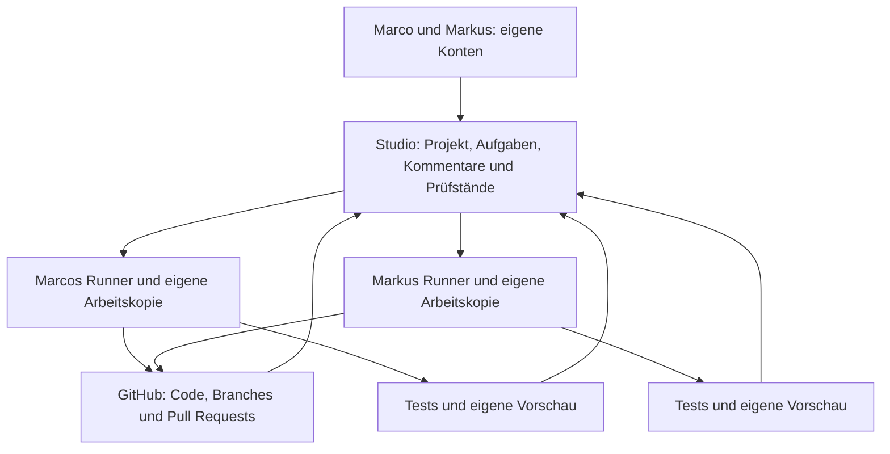

# SCHMAQQ Workspace – Gesamtplan und nächste Arbeit

_Planungsstand 17.10.2026. Dieser Plan ordnet die Arbeit; der technische
Iststand mit Nachweisen bleibt in [STATUS.json](STATUS.json). Keine
Deployment-, Merge- oder Providerfreigabe durch diesen Text._

## Wofür wir das bauen

Marco in der Schweiz und Markus in Thailand sollen gleichzeitig digitale
Services entwickeln können. Beim Öffnen eines Projekts versteht jeder:
Was ist das Ziel? Wer arbeitet woran? Welche Rückfragen sind offen? Welcher
Stand ist getestet und kann übernommen werden?

SCHMAQQ Workspace hält diesen gemeinsamen Kontext zusammen. Studio ist der
erste Bereich für Entwicklung. Der Mehrwert entsteht durch die Verbindung von
Aufgabe, Gespräch, eigener Arbeitskopie, Ergebnis und Prüfung. Eure vorhandenen
Werkzeuge bleiben Teil dieses Ablaufs.

**Nächster Meilenstein:** Beide erledigen im selben Testprojekt unabhängig je
eine Aufgabe, besprechen sie im Studio, führen echte Tests aus, sehen ihre
Vorschau und prüfen das Ergebnis des anderen. Der Ablauf muss für euch ohne
ständige Agentenerklärung verständlich sein.

## So gehören die Teile zusammen

Das Bild beschreibt den angestrebten vollständigen Ablauf. Der gemeinsame
GitHub-Fernpilot ist noch offen; der lokale Zwei-Rollen-Test ist bereits belegt.

| Bestandteil | Aufgabe | Grenze |
| --- | --- | --- |
| `schmaqq-workspace` | Code und Dokumentation des Workspace/Studio | Eigenes Repository und eigener Release |
| `NetzKontor` | Bestehende SCHMAQQ-Website und Services | Separates Produkt; Integration als eigener späterer Auftrag |
| Live-Studio auf VPS | Gemeinsamer Projektkontext, Konten und Auftragsvermittlung | Führt keine Jobs eines ausgeschalteten Heim-PCs aus |
| Persönlicher Runner | Git, Dateien, Tests und freigegebene KI auf dem jeweiligen Rechner | Eigene Identität und freigegebene Projektpfade |
| GitHub | Versionierte Codebasis, Branches, gemeinsame Prüfung und Zusammenführung | Kein Ersatz für den laufenden Studio-Dienst |
| Persönliche KI-Zugänge | Eigene KI-Unterstützung bei der Entwicklung | Studio-Anmeldung ist keine Modellberechtigung |
| Hermes / befugter Betreiber | Gesondert freigegebener Serverbetrieb | Keine automatischen Produktionsänderungen aus einer Entwicklungsaufgabe |

## Wo wir tatsächlich stehen

| Bereich | Einordnung | Nächster fehlender Nachweis |
| --- | --- | --- |
| Private Codebasis | Gesichert, Kandidat in Draft-PR #6 | Review und freigegebener Release-Stand |
| Live-Studio | Älterer Stand läuft; HTTPS und eigener Dienst geprüft | Aktuelles Live-Backup und Wiederherstellung |
| Marcos Windows-Runner | Eingerichtet, echter Funktionstest; zuletzt online | Kein erneutes Setup; Reconnect nach Update prüfen |
| Gemeinsame neue Oberfläche | Lokal mit zwei Testrollen und Runnern geprüft | Zusammengehörigen Kandidaten kontrolliert bereitstellen |
| Gleichzeitige Entwicklung | Eigene Kopien, parallele Tests und gegenseitige Reviews lokal belegt | Tatsächlich Marco + Markus über Entfernung |
| Einfacher Einstieg | Erste Kopie und Layout verbessert | Einrichtung und Verständlichkeit mit Markus beobachten |
| Kontoverbindungen | Lokale GitHub-Identitätsverknüpfung vorbereitet | Echter Client und persönliche Zustimmung; kein Repozugriff dadurch |
| Persönliche KI-Nutzung | Runnerweg vorhanden, persönlicher End-to-End-Auftrag offen | Ein kleiner ausdrücklich freigegebener Auftrag je Person |
| Weitere Kunden / Compute | Zukunftsbild | Eigene spätere Produkt- und Sicherheitsphasen |

Live-Befund: [LIVE_PREFLIGHT_20261017.md](LIVE_PREFLIGHT_20261017.md).
Der VPS hat laut dieser Momentaufnahme etwa 28,5 GiB frei. Zusätzliche
Infrastruktur ist für den nächsten Pilotstand nicht begründet.

## Reihenfolge mit klarer Abnahme

| Paket | Konkretes Ergebnis | Erledigt, wenn | Wer / Abhängigkeit |
| --- | --- | --- | --- |
| P1 – Kandidat abschließen | Ein geprüfter, eindeutig bestimmter Release-Kandidat aus Draft-PR #6 | Änderungen gegen main geprüft, Befunde behoben, exakter Stand isoliert unter Linux samt Runtime-Smoke geprüft; kein Merge nötig für die Prüfung | Engineering; Windows- und Browserbelege wiederverwenden |
| P2 – Sicher bereitstellen | Derselbe Stand läuft als zusammengehöriges Frontend und Backend | Live-Snapshot und Restore belegt; freigegebener Dienstwechsel; Login, Datenbestand, Runner und HTTPS bleiben funktionsfähig; Rückweg festgehalten | Befugter Betreiber; konkreter Release und gesonderte Betriebsfreigabe |
| P3 – Zwei echte Personen verbinden | Markus hat eigenen Zugang und Runner; beide erreichen denselben freigegebenen Test-Remote | Beide können den Remote lesen und in ihren eigenen Branch schreiben; keine geteilten Tokens; Marcos Runner bleibt bestehen | Engineering + persönliche Anmeldung beider; Test-Remote ausdrücklich freigeben |
| P4 – Zusammenarbeiten abnehmen | Zwei Aufgaben durchlaufen den vollständigen gemeinsamen Ablauf | Aufgaben, Rückfragen, unabhängige Kopien, parallele Tests, Vorschauen und gegenseitige Prüfung von euch tatsächlich benutzt; Testbranches kontrolliert zusammengeführt | Marco + Markus, technisch begleitet; P2/P3 |
| P5 – Einstieg vereinfachen | Beobachtete Hürden aus diesem Pilot sind behoben | Wiederholter Einstieg und Reconnect ohne Terminalanleitung/Tokenkopieren soweit technisch möglich; verbleibende persönliche Freigaben verständlich; keine irreführenden Erfolgsanzeigen | Engineering; nur beobachtete Hürden priorisieren |
| P6 – Eigene KI praktisch nutzen | Beide können einen kleinen Auftrag mit eigener freigegebener KI ausführen | Tatsächliches Ergebnis mit persönlichem Auftraggeber, richtigem Projekt, Tests und sichtbarem Fehlerfall; keine fremde Kontoübernahme | Engineering + persönliche Zustimmung; funktionierender menschlicher Ablauf zuerst |
| P7 – Alltag mit SCHMAQQ | Ihr entwickelt ein reales abgegrenztes Service-Vorhaben im Studio | Ein vereinbartes Arbeitsergebnis wird über denselben Ablauf fertig; Entscheidungen bleiben auffindbar; Änderungen im Zielrepo separat autorisiert | Marco + Markus; Pilot und zentrale Hürden abgeschlossen |

**Jetzt aktiv: P1.** P2 ist vorbereitet; der lesende Live-Audit muss nicht
wiederholt werden, solange sich Betrieb oder zeitlicher Kontext nicht wesentlich
ändern. P3–P7 sind geordnetes Backlog. Persönliche Anmeldungen werden erst dann
angefragt, wenn der jeweilige Schritt bereitsteht.

Für P2 gilt der konkrete Ablauf einschließlich Rückweg aus dem Live-Preflight.
Für P3/P4 gilt [PILOT_PLAN.md](PILOT_PLAN.md). Bereits bestandene Windows-
und Runner-Prüfungen nicht bei jeder Übergabe erneut durchführen.

## Was parallele Arbeit bei uns bedeutet

Jeder bearbeitet eine eigene Aufgabe in einer eigenen Arbeitskopie und einem
eigenen Branch. Die gemeinsame Übersicht zeigt Zuständigkeit und betroffene
Dateibereiche. Diskussionen bleiben an der Aufgabe. Prüfung und Zustimmung
beziehen sich auf einen bestimmten Code-Stand.

Zwei Personen können trotzdem dieselbe Datei verändern. Sichtbare Bereiche
helfen beim Abstimmen; sie garantieren keine konfliktfreie Zusammenführung.
Im Pilot wird daher zusätzlich eine absichtliche Überschneidung geprüft:
Konflikt sichtbar machen, gemeinsam entscheiden, kontrolliert auflösen und
erneut testen. Stilles Überschreiben darf nicht als Erfolg gelten.

Gegenseitige Studio-Freigabe und GitHub-Merge sind unterschiedliche Schritte.
Nach der ersten Übernahme muss die zweite Änderung gegen den neuen gemeinsamen
Stand geprüft werden. Gleichzeitiges Bearbeiten desselben Editorpuffers wie in
einem gemeinsamen Dokument ist kein aktuelles Produktversprechen.

## So führen wir die Arbeit effizient fort

- Ein aktives Paket und darin eine konkrete nächste Aufgabe. Vor Start stehen
  Nutzen, betroffene Teile und beobachtbares Fertigkriterium fest.
- Kleine, prüfbare Änderungen auf einem eigenen Branch. Kein neuer Prototyp,
  kein Architekturumbau nebenbei und keine weitere Dashboardfunktion vor P4.
- Passende Tests für geändertes Verhalten. Vor einer Codeübergabe vollständiger
  Check; sichtbare UI-Prüfung bei Oberflächenänderungen. Vor einem Release
  zusätzlicher Linux-/Runtime-Nachweis. Reine Dokumentpflege benötigt keinen
  erneuten Build aller unveränderten Komponenten.
- GitHub Actions bleibt derzeit unkonfiguriert. Vorhandene lokale Prüfungen und
  gezielte isolierte Linux-Prüfung nutzen; zusätzliche CI erst bei konkretem
  Bedarf und geklärtem Kontingent. Prüfresultate an den Quellstand binden.
- Nach jedem Paket: Ergebnis, Beleg, offene Hürde und genau nächster Schritt
  festhalten. Keine Fertigmeldung nur aufgrund eines Buttons oder Mock-Ergebnisses.
- Keine Stundenprognosen ohne Grundlage. Aufwand nach P1/P4 anhand tatsächlicher
  Reviewbefunde und Bedienprobleme neu einordnen.

Fertig für den Pilot heißt: Beide können ihren Ablauf mit verständlicher
Anleitung selbst wiederholen; Fragen und Fehler sind sichtbar; bestehende Daten
bleiben erhalten. Bloße technische Erreichbarkeit erfüllt dieses Kriterium nicht.

## Danach ausbauen, ohne das Ziel zu verlieren

1. **Verlässlicher Alltag:** Wiederanmeldung, Reconnect, nachvollziehbare Fehler,
   Sicherungen, Datenexport und kleine Releases. Erst bei tatsächlichem Bedarf
   eine getrennte Ausführung auf einem dauerhaft laufenden Rechner einrichten.
2. **Passende zusätzliche Tools:** Jeweils einen benötigten Anbieter integrieren
   und Ende zu Ende prüfen. Anmeldung, Repositoryrechte und KI-Nutzung getrennt
   behandeln. OAuth bevorzugen, wo ein unterstützter Weg vorliegt; Details erst
   beim jeweiligen Integrationsauftrag gegen aktuelle Anbieterdokumentation prüfen.
3. **Dienst für weitere Teams:** Mandantentrennung, Rollen, Kontenlebenszyklus,
   Betrieb und Support vor fremden Kundendaten und offener Registrierung.
4. **Weitere Workspace-Bereiche und Compute:** Fachabläufe über Entwicklung hinaus;
   freiwillige Ressourcenfreigabe erst mit Isolation, Widerruf und Limits.
   Monetarisierung folgt erst nach technischem und vertraglichem Nachweis.

Die größere Vision bleibt erhalten. Die Reihenfolge wird an eurem tatsächlichen
Nutzen gemessen: schneller gemeinsam ein verlässliches Ergebnis fertigstellen.

## Welche Dokumentation wofür gilt

| Frage | Einstieg |
| --- | --- |
| Was bauen wir und was folgt als Nächstes? | Diese Roadmap |
| Was funktioniert nachweislich? | [STATUS.json](STATUS.json) |
| Wie wird der nächste gemeinsame Pilot abgenommen? | [PILOT_PLAN.md](PILOT_PLAN.md) |
| Wie erfolgt der kontrollierte Betriebswechsel? | [LIVE_PREFLIGHT_20261017.md](LIVE_PREFLIGHT_20261017.md) |
| Wie setzt ein neuer Agent ohne alten Chat fort? | [HANDOFF.md](HANDOFF.md), danach relevanter Quellcode |
| Was ist das langfristige Ziel und was bleibt getrennt? | [PRODUCT_VISION.md](PRODUCT_VISION.md), [ARCHITECTURE.md](ARCHITECTURE.md), [INTEGRATION_BOUNDARIES.md](INTEGRATION_BOUNDARIES.md) |

## Historische R1-Planung

Der folgende frühere Plan bleibt als Vorgeschichte erhalten. Seine damaligen
Statusangaben und „nächsten Schritte“ sind historisch; die aktuelle operative
Reihenfolge steht oben, technische Nachweise in STATUS.json. Die alten R-Labels
sind keine neuen parallelen Arbeitsaufträge.

---

# SCHMAQQ Workspace — Roadmap und Prüfgates
_Status: R1-Planung, 17.10.2026. Reihenfolge statt künstlicher Termine. Jede Phase braucht beobachtbare Evidence._

## Zielprinzip

**Zuerst ein nützliches echtes Zwei-Personen-Produkt, dann universelle Arbeitsabläufe, dann ein sicheres offenes Ausführungsnetzwerk.** Repositorien, Domains und Infrastruktur sind Mittel, nicht der Nutzerwert. Keine Marketing- oder Monetarisierungsversprechen ohne Betriebsnachweis.

### R0 — Repository-Übertragung [nachgewiesen]
- Private Codebasis `Spezzo-sudo/schmaqq-workspace`, Historie übertragen, Startdokumentation vorhanden.
- Lokale Quelle: 13 Backendtests, TypeScript, Source-Guard, Frontend-Build PASS laut Übertragungs-Evidence 17.10.2026.
- Fehlende Nachweise: Cloud/Linux-Installation, Hermes-Linux-Testlauf, Browser, tatsächlicher Zwei-Personen-Betrieb, VPS. GitHub Actions ist bewusst kein verpflichtendes Gate.
- **Gate:** Migration von GitHub lesbar; kein Production-Change. Kein Anspruch, dass alle Plattformfunktionen produktiv sind.

### R1 — Vision/Architektur (dieser PR) [in Review]
**Lieferobjekte:** `PRODUCT_VISION.md`, `ARCHITECTURE.md`, `ROADMAP.md`, ADR-Vorschläge, Plattform-Integrationsgrenzen und Referenzen in Einstiegstexten.

**Gate:** Owner prüft, dass Universal-Workspace, Studio als Modul, optionale Agenten, langfristiges Compute-Netzwerk, Sicherheit und Monetarisierungsoptionen korrekt beschrieben sind. Keine Laufzeitänderung. Erst Merge macht den Stand zur im Repo akzeptierten Richtung.

### R2 — Frischer Cloud-/Linux-Start mit Hermes-Test-Evidence [nächster Engineering-Block]
**Auftrag:** Auf einem frischen Linux-Checkout mit Node >=24.15.0 / Git / Python 3 reproduzierbar installieren, `node selfhost/cloud-setup.mjs`, `npm run studio:verify`. Die reale Suite läuft über Hermes auf einem gesonderten, autorisierten Linux-Test-Runner. Keine neuen automatischen GitHub-Actions-Workflows; kein Umgehen von Fehlern. Browserabnahme der Demo am Desktop und Mobil-Viewport. Nachweis: Logs, Commit, ggf. Screenshots und reproduzierbare Befehle.

**Gate:** Wiederholbarer Linux-Green-Run; install/build/test getrennt dokumentiert; fehlerfreier Demo-Start; keine produktiven Credentials/Deployments; Hinweis auf weiterhin fehlende echten Mehrbenutzerbetrieb. Alte fehlgeschlagene NetzKontor-CI gilt nicht als aktueller Studio-Test.

### R3 — Tatsächlicher Zwei-Personen-Pilot + klare Admin-UX
**Auftrag:** Zwei echte Benutzerkonten, zwei unabhängige Browserprofile und Geräte, Anmeldung/Einladung, Projekt, Task, Kommentar/Datei, Codex- oder rein menschlicher Bearbeitungsablauf, echte Tests, Vorschau, unabhängiges Review und Freigabe. Die UI braucht einen **auffindbaren** Admin-/Einstellungszugang für berechtigte Personen; Serverrechte prüfen. Kein pauschaler Zugriff für beliebige Nutzer.

**Gate:** Abläufe und Negativfälle dokumentiert (falscher Benutzer, fremder Runner, verlorene Verbindung, Konflikt, abgelehnte Review, abgebrochener Job). PC aus = Studio-Webzugang später noch erreichbar; dessen lokaler Runner entsprechend offline. Kein Fake-Erfolg.

### R4 — Isolierter Dauerbetrieb [erst nach explizitem Owner-Go]
**Auftrag:** Hostinger-VPS **read-only** preflight: RAM, Speicher, Ports, Reverse Proxy, Backups, isolierte Pfade. Danach eigener, unprivilegierter Studio-Dienst mit separaten Origins für Studio und Vorschau, HTTPS, persistenter DB, Backup und Restore. Keine Mitbenutzung von NetzKontor-DB, Docker-Socket oder persönlichen Auth-Caches.

**Gate:** Zwei reale externe Logins, getrennte Datenpfade, Dienstneustart mit Datenpersistenz, Backup/Restore getestet, Rollback, Sicherheit und Browserprüfung. Kein Production-Deployment ohne gesonderte Freigabe.

### R5 — Universeller Workspace und Anbieter-Adapter
**Auftrag:** Aufgaben/Artefakte/Entscheidungen auch ohne Git, generische Agenten-/Provider-Schnittstelle, explizite Rechte, Prozesskosten-/Budgetgrenzen, breitere Teamrollen, exportierbarer Kontext. Optional frühes SSO mit Hauptwebsite über geprüften Vertrag, nicht DB-Zugriff.

**Gate:** Gleicher Auftragstyp über menschlichen Ablauf und zwei voneinander unabhängige Ausführungsadapter möglich; jedes Ergebnis hat sichtbare Herkunft, Budget und Freigabe. Benutzer können Agenten ohne Datenverlust deaktivieren.

### R6 — Multi-Tenant- und Integrationsreife
**Auftrag:** Organisationen/Workspaces voneinander isolieren, vollständige API-Objektprüfungen, Einladungs-/Kontenlebenszyklus, Admin, Aufbewahrung, Monitoring, Restore und klare Website-/Studio-Navigation. Datenmigration vom persönlichen Einzel-Studio kontrolliert planen.

**Gate:** Negativtests für Cross-Tenant-Lesen/Schreiben, Rechtemissbrauch und Datenexport; wiederholbare Deployments und Wiederherstellung. **Vorher keine offene Kundenregistrierung.**

### R7 — Vertrauenswürdiges Compute-Pilotnetz
**Auftrag:** Freiwillige Gerätefreigabe mit Capability-Discovery, Anbieterzustimmung, Quotas, fein abgestuften Jobtypen und einem isolierten Worker-Pilot **nur mit bekannten, autorisierten Parteien**. Unvertrauenswürdigen Code aus fremden Projekten grundsätzlich nicht auf normale private Runner lassen. Metering und Kostenbelege zunächst ohne Zahlungen.

**Gate:** Isolation, Abbruch, Revocation, Offline-Verhalten, Datenklassifikation, begrenzter Egress, reproduzierbare Messwerte und Audit sicher demonstriert. Keine Auszahlung oder Öffnung für die Öffentlichkeit.

### R8 — Marketplace- und Geschäftsmodellprüfung
**Auftrag:** Preiseinheiten, Vermittlungsgebühr, verifizierbare Nutzung, Zahlungsfluss, Refunds/Disputes, steuerlich/rechtliche und providervertragliche Voraussetzungen, Support und Abuse-Management prüfen. Erst danach begrenzte Monetarisierung testen.

**Gate:** Sichere und faire technische Abrechnung plus geklärte Anbieterbedingungen. Keine Weitervermarktung fremder Abos oder Tokens ohne Berechtigung.

## Die drei unmittelbar wichtigsten Arbeitspakete

| Rang | Paket | Konkreter Output | Nicht Teil davon |
| --- | --- | --- | --- |
| 1 | **R2-A: Linux + CI** | Cloud-Setup und `studio:verify` unter isoliertem Linux/Hermes nachweisbar, Fehler dokumentiert/behandelt | VPS, Auth-Provider oder grosser Refactor |
| 2 | **R2-B/R3-A: Sichtbares Produkt** | Browser-Demo und zwei Rollen mit echten Aufgaben/Dateien/Review, dokumentierte UX-Lücken | Allgemeiner AI-Marktplatz |
| 3 | **R3-B/R4-A: Zugang & Betriebsvorbereitung** | Admin auffindbar, Rechtegate geprüft, VPS-Preflight nur lesend | Eigenmächtige Production-Änderung |

## Testausführung ohne GitHub-Actions-Quota

- Hermes ist für R2 die vorgesehenen Ausführungsinstanz, nicht GitHub Actions. `docs/HERMES_TEST_RUNBOOK.md` auf dem R2-Branch enthält das genaue Testverfahren; bei Merge von PR #2 wird es Teil von main.
- Tests nur auf einem isolierten, autorisierten Linux-Testhost mit Node >=24.15.0. System-Node auf dem produktiven VPS v22.22.2 nicht verändern; keine Tests ohne sichere Sandbox und passende Rechtegrenzen.
- Saubere SHA-/Node-/npm-/Install-/Test-Evidence dokumentieren. Browser-/Mobilabnahme und echter Mehrbenutzerbetrieb bleiben separate Gates.

## Abhängigkeitsregeln

- Eine frühe UX-Preview darf lokal/isoliert stattfinden; das begründet **keine** öffentliche Freigabe.
- Vor internetweitem Pilot: TLS, authentifizierte Sessions, berechtigte Runner, Backups und nachvollziehbare Sicherheitsgates.
- Vor externen Teams: Mandantentrennung.
- Vor fremden Compute-Nodes: starke Sandbox, Missbrauchsschutz und Einwilligung.
- Vor Gebühren: verlässliches Metering, Limits und Zahlungs-/Vertragsklärung.
- NetzKontor-Umbenennung und `studio.schmaqq.com` sind **separate**, überprüfte Plattform-/Domain-Arbeiten, keine Blocker für R2.

## Fortschrittsführung

`docs/STATUS.json` bleibt alleiniger technischer Ist-Snapshot im Studio-Repository. Nach einem bestandenen Arbeitsblock dort **nur tatsächlich nachgewiesene** Änderungen vermerken. PR-Beschreibungen enthalten genaue Tests/Evidence und unveränderte Risiken. Produktvision/Architektur enthalten bewusst keine schnell veraltenden Commit-SHAs.

Referenzen: [PRODUCT_VISION.md](PRODUCT_VISION.md) · [ARCHITECTURE.md](ARCHITECTURE.md) · [INTEGRATION_BOUNDARIES.md](INTEGRATION_BOUNDARIES.md) · [HANDOFF.md](HANDOFF.md).
