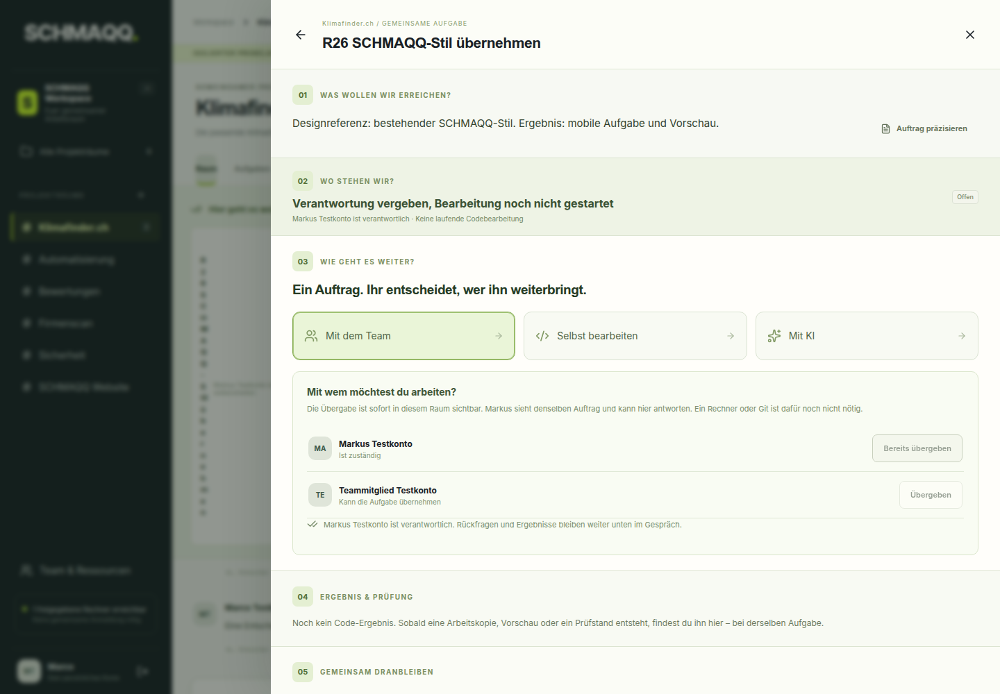
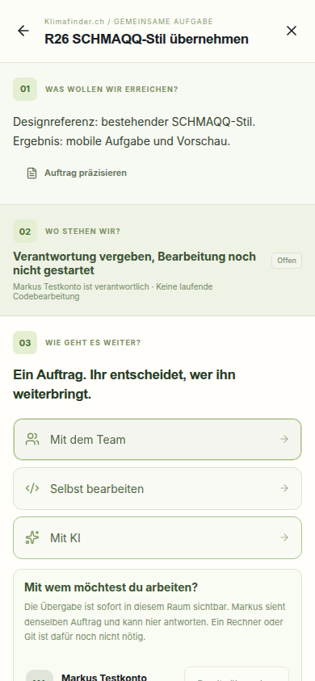

# R26 „Ein Auftrag – ein Arbeitsfluss“: Abnahme 25.10.2026

Status: isolierter Source-Kandidat, kein Merge, kein Production-Deployment.

## Ausgangslage

Marcos realer R25-Handyablauf war trotz technischer Tests praktisch zu
kompliziert: eine Aufgabe musste zwischen vier Reitern und mehreren
technischen Einrichtungsbereichen verfolgt werden. Ein eigenes
Übernehmen konnte den Status auf „In Arbeit“ setzen, obwohl keine
Ausführung stattgefunden hatte.

R26 ersetzt den **normalen Aufgabeneinstieg**, nicht den sicheren
bestehenden Git-/Runner-/Codex-Unterbau.

## Backend- und Browser-Nachweise

- `node selfhost/verify.mjs`: **190 Tests, 187 PASS, 0 FAIL, 3
  erwartete Linux-Skips**. TypeScript, Source Guard, Vite-Build PASS.
- Neue R26-HTTP-Tests: Handoff an konkreten Teampartner ohne
  Statusmutation, alte Eigentümer/konkurrierende Übergaben abweisen,
  bestehende Worktree-Reservierungen achten, Auftrag mit revisions-
  geschützt bearbeitbarem Titel/Ergebnis und persistiertem Inhalt.
- `scripts/r26-flow-browser.py`: **13 von 13 Chrome-Prüfpunkten** auf
  echter gerenderter Anwendung. Desktop 1440×1000, Smartphone 390×844,
  zwei unterschiedliche synthetische Personen, zwei isolierte echte
  Node-/Git-Runner aus der vorhandenen Testfixture.
- Eine Aufgabe kann direkt erstellt, präzisiert und an das zweite
  Konto übergeben werden. Das zweite Konto sieht dieselbe Aufgabe,
  kann einen Kommentar schreiben, und das erste Konto sieht den
  Kommentar ohne Umwege.
- Die Aufgabe hat keine vier Tab-Navigationen mehr. Der normal
  sichtbare Status nennt ausdrücklich, wenn zwar eine Person
  verantwortlich ist, aber noch keine Codeausführung gestartet wurde.
- „Selbst bearbeiten“ erreicht eine echte isolierte Git-
  Arbeitskopie und den vorhandenen Editor. Kein neues Repository,
  echte persönliche Runner- oder Provideranmeldung im Test.
- Kein lokales KI-Modell verfügbar: UI sagt das ehrlich und
  bietet keinen fiktiven KI-Start an.
- Browserneuladen und Handy-Entwurf bleiben im gleichen
  Aufgabenbezug. Mobile Breite ohne horizontalen Überlauf.
- Keine ungefangenen Browserfehler. **Production wurde nicht
  verändert.**

## Testwahrheit / offene Grenzen

Die im Browser dargestellten Namen „Marco Testkonto“ und „Markus
Testkonto“ sind vollständig synthetisch. Die zweite Testidentität ist
keine persönliche Bedienungsabnahme durch Markus. Es gab keine echte
Codex-Inferenz, kein externes ChatGPT-Protokoll, keine neue
GitHub-Verbindung und keine Änderungen an den echten Produktions-
Accounts, Repositories oder Runner-Tokens.

Der erste lokale Runner-/Git-Setup-Schritt ist weiterhin eine
gesonderte technische Verbindung. R26 erleichtert die tägliche
Bedienung und Übergabe, ersetzt aber nicht diese einmalige
Einrichtung. Erst eine echte zwei-Personen-Nutzungsprüfung darf
diese Abhängigkeit als gelöst einstufen.

Der R25-H3-Historienhinweis `HISTORICAL_OWNER_MISMATCH` wurde hier
nicht verändert oder als PASS ausgegeben. Ein eventueller
Produktionswechsel erfordert erneut aktuelle Backup-, Restore-,
Release- und H3-Scope-Prüfungen plus separate Owner-Freigabe.

## Reproduktion

```bash
node selfhost/verify.mjs
python3 scripts/r26-flow-browser.py \
  --node /opt/schmaqq-studio/runtime/node/bin/node \
  --output /PRIVATE/NEW/TEST-RESULTS
```

Die Browserfixture verwendet ausschliesslich disposable Loopback-
Zustände und räumt ihre eigenen Prozesse/Daten wieder auf.
Persönliche Zugangsdaten gehören nicht in diese Belege.

## Echte Bildnachweise




