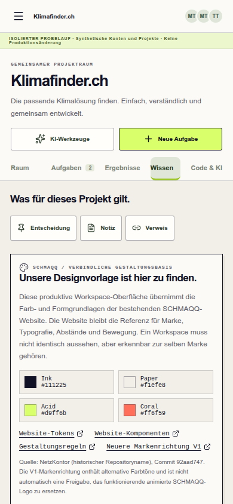
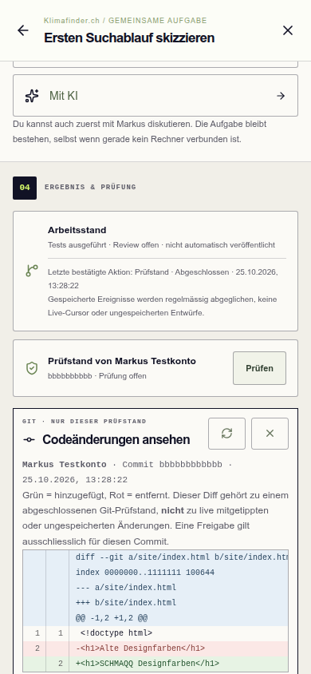
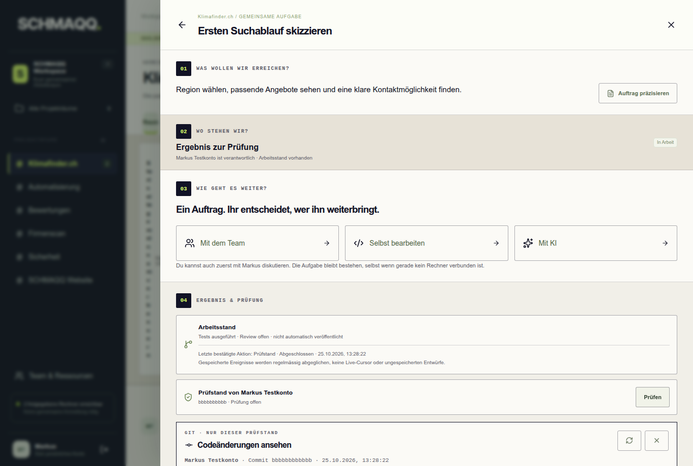

# R27: Designfamilie + aufgabenbezogener Git-Diff — Abnahme

**Status:** isolierte Testdaten. Der produktive SCHMAQQ-Workspace R26
wurde nicht verändert. Keine echten Owner- oder Markus-Passwörter,
Runner-Tokens, Repositories oder Arbeitskopien wurden benutzt.

## Funktionaler Nachweis

Source `Spezzo-sudo/NetzKontor`, Marketing Commit
`92aad74781c03c7414d5a7adfd6c0568ad82c99b` (nicht die alte
NetzKontor-Marke):
`marketing/site/assets/entry-root.css`, `styles.css`, `r6.css`,
`r9.css` und dokumentierter Designkonvergenzplan.

**Gefundener Drift:** die bestehenden R25/R26-Projekträume verwendeten
eigene grünliche Flächen, Inter/Arial, starke Rundungen, obwohl `brand.css`
bereits die Marketingfarben kannte. R27 nutzt jetzt gemeinsame, fest
versionierte SCHMAQQ-Tokens in einem eigenen CSS-Bridge-Modul und
stellt die Designquellen unter „Wissen“ bereit.

## Source- und API-Regressionen

- Source Guard, TypeScript und Vite: PASS.
- `node selfhost/verify.mjs`: **190 Tests, 187 PASS, 0 FAIL,
  3 erwartete Linux-Skips.**
- Neue API-Prüfungen: nur angemeldete Teammitglieder sehen
  taskgebundene, abgeschlossene Review-Diffs. 401 anonym,
  404 fremde Aufgabe oder unbekannter Review, 400 ungültige ID.
  Unvollständiger Diff liefert keinen Quellcode.
- Activity-Board teilt nur Aktionstyp, Status und Datum mit; keine
  privaten Dateipfade, Inhalte, Prompts, Provider-Credentials oder
  Jobausgaben.

## Realer isolierter Chrome-Test

`python3 scripts/r27-design-diff-browser.py --node
/opt/schmaqq-studio/runtime/node/bin/node --output /PRIVATE/OUTPUT`

**8 von 8 Prüfungen bestanden:**

1. Zwei getrennt angemeldete synthetische Browseridentitäten.
2. Verbindliche Website-Tokens in Projektwissen auffindbar,
   einschließlich exakt gerenderter CSS-Farbwerte.
3. Letzter bestätigter Arbeitsvorgang direkt in der Aufgabe sichtbar.
4. Codeänderung bei „Prüfen“ tatsächlich sichtbar: Rot für entfernt,
   Grün für hinzugefügt, Zeilennummer und historischer Commit-Bezug.
5. Zweites Konto sieht denselben Prüfstand ohne Zugriff auf
   persönliche Arbeitskopie.
6. 390-Pixel-Handy ohne horizontalen Überlauf der Seite;
   Codeblock ist absichtlich separat horizontal scrollbar.
7. Diff lässt sich schliessen, Aufgabe und Verlauf bleiben erhalten.
8. Keine ungefangenen JavaScript-Browserfehler.

**Wahrheitsgrenze:** Der im Browser dargestellte Git-Diff stammt aus
synthetischen Fixture-Daten. Das beweist die End-to-End-Darstellung
und die API-Grenzen, aber nicht die Code-Ausführung auf Markus'
persönlichem Rechner oder echte WebSocket-Collaboration.
Der zuvor separat erfolgreich durchlaufene R26-Git-Pilot prüft
isolierte echte lokale Node-/Git-Arbeitskopien. R27 hat keine neue
gleichzeitige Dateieditierung implementiert.

## Screenshots der tatsächlich gerenderten UI

## Release-Grenzen

Diese Source-Abnahme ersetzt **keine** imimmutable Release-Abnahme,
keinen persönlichen Zwei-Personen-Pilot und keine produktive
Backup-/Restore-/H3-Betreiberprüfung. Die frühere H3-Archivgrenze
`BLOCKED_HISTORICAL_OWNER_MISMATCH` ist weiterhin ungelöst.
Kein Merge oder Deployment ohne separate Besitzerfreigabe.
