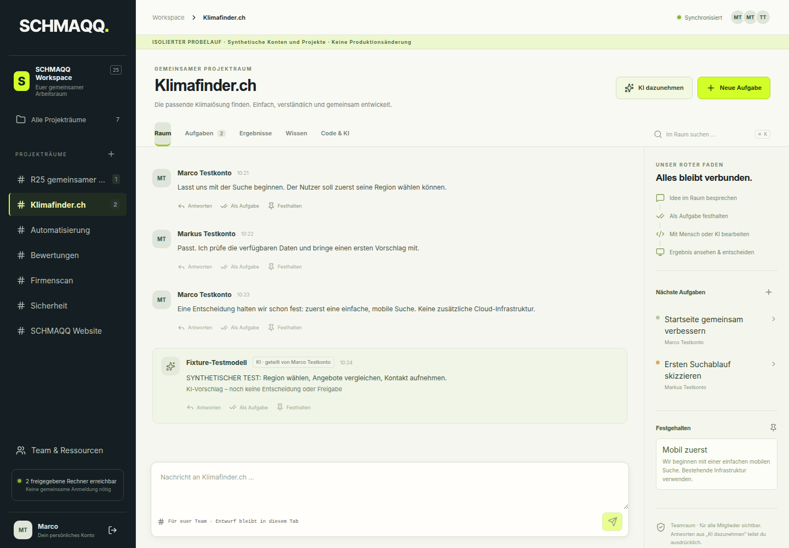
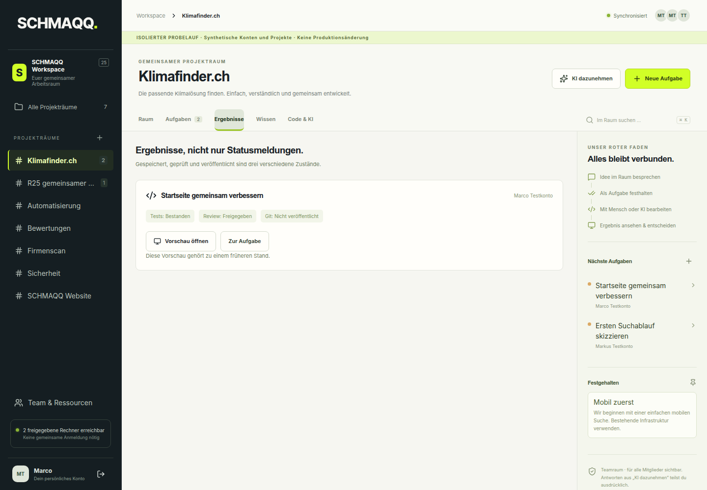
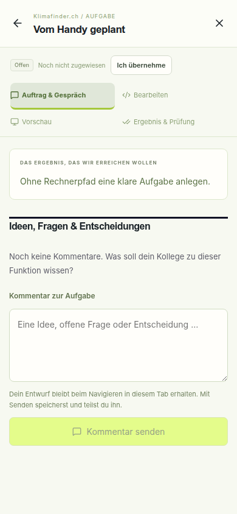

# R25 Workspace Rooms – funktionale Abnahme

**Status:** isolierter Engineering-Kandidat. Nicht gemergt und nicht produktiv.

## Was sich gegenüber dem bisherigen Einstieg ändert

Der normale Start ist ein Projektraum ohne lokalen Pfad. Gespräch, Aufgabe,
Entscheidung, Ergebnis und Ausführung behalten denselben Projektbezug.
Die technische Verbindung ist bewusst eine spätere Handlung, kein Pflichtfeld
für eine Idee am Handy. Die vorhandene sichere Runner-/Git-/Review-Grenze bleibt.

## Automatische Source-Verifikation

`node selfhost/verify.mjs`: **188 Tests, 185 PASS, 0 FAIL, 3 erwartete Skips**.
Source Guard, TypeScript, Vite-Build und `git diff --check` bestanden.

Neue API- und Navigationsregressionen prüfen insbesondere:

- Authentifizierung/Origin, Eingabegrenzen und idempotente Wiederholung;
- Nachrichten, Antworten und genau eine Aufgabe je konvertierter Quellnachricht;
- Quellbezug innerhalb desselben Raums, keine projektfremde Referenz;
- Entscheidungen und begrenzter, nachvollziehbarer KI-Kontext;
- HTTPS-Verweise ohne Zugangsdaten oder versteckte Tokenparameter;
- GitHub-Verweis nur als Referenz, Revisionskonflikt statt Überschreiben;
- explizite Gerätefreigabe, veralteter Kontext, Offline-/Widerrufsfall;
- private lokale KI-Ausgabe, Teilen nur durch tatsächlichen Auftraggeber;
- Nachrichten-Pagination, alte Direktlinks und interne Rückkehr nach Anmeldung.

## Realer Browser: durchgängige Source-Abnahme

Chrome über Playwright, Desktop 1440×1000 und Handyviewport 390×844.
Zwei separat angemeldete synthetische Benutzer plus ein unbeteiligtes Testkonto.
Zwei echte isolierte Node-Runner mit eigenen Git-Klonen/Worktrees; alle Daten
und Prozesse gehören zum Wegwerftest, nicht zu Marcos oder Markus' Geräten.

**22 Prüfpunkte bestanden:**

| Schritt | Nachweis |
| --- | --- |
| Persönliche Konten | Getrennte Browser-Sitzungen und sichtbare Benutzeridentität. |
| Projekt am Handy beginnen | Projektname/Ziel reichen, kein Pfad/Git/Gerät erforderlich. |
| Gespräch speichern | Nachricht im Raum persistent sichtbar. |
| Zusammenarbeiten | Zweites Konto liest und antwortet; erstes sieht die Antwort. |
| Nachricht zur Aufgabe | Quellverknüpfung bleibt, Aufgabe öffnet im selben Raum. |
| Zuständigkeit/Gespräch | Zweites Konto übernimmt und kommentiert; erstes sieht beides. |
| Entscheidung | Bewusst festgehaltene Aussage erscheint im Projektwissen. |
| Unterbrechen | Nachrichtenentwurf bleibt über Tabwechsel und Neuladen. |
| Externe Verweise | Repository/Chat als Verweis, nicht als fiktive Integration. |
| Kein Modell verfügbar | Verständlicher Zustand ohne Sperre für Planung. |
| Gemeinsame Modellressource | Besitzer erteilt Freigabe; Auftrag trägt Projektkontext. |
| Antwort teilen | Drittes Konto sieht private Antwort nicht; erst explizites Teilen veröffentlicht sie im Raum. |
| Echter Code | Git-Arbeitskopie, Datei öffnen/ändern/speichern; Tests bei ungespeichertem Entwurf gesperrt. |
| Echte Tests | Konfigurierter Node-Test läuft im tatsächlichen Worktree. |
| Vorschau | Tatsächlicher Build, HTML auf getrennter Vorschau-Origin sichtbar. |
| Prüfstand | Echter Git-Commit, vollständiger Diff und Testbericht sichtbar. |
| Zweitprüfung | Zweiter Benutzer gibt genau diesen Commit frei. |
| Ergebnisstatus | Tests bestanden, Review freigegeben, Git noch NICHT veröffentlicht. |
| Handy | Menü, Aufgabe anlegen und Dialog ohne horizontalen Seitenüberlauf. |
| Wiederaufnahme | Aufgabenbereich nach mobilem Reload wiederhergestellt. |
| Alte Links | Vorhandene Projekt-/Aufgaben-URL führt in den neuen Raum. |
| Browserfehler | Keine ungefangenen JavaScript-Ausnahmen im abgeschlossenen Lauf. |

Der Modelloutput ist ausdrücklich **synthetisch** über die echte authentifizierte
Runner-Poll-/Report-Schnittstelle eingespeist. Damit sind Vermittlung, Freigaben
und Rückfluss geprüft – nicht Modellqualität, echte Inferenz oder ein fremdes
KI-Abonnement. Die eigentlichen Code-/Test-/Build-/Git-Befehle sind dagegen echt.

## Reproduzierbarkeit

```
python3 scripts/r25-room-browser.py \
  --node /opt/schmaqq-studio/runtime/node/bin/node \
  --output /PRIVATE/NEW/OUTPUT
```

Für den finalen Immutable-Release-Nachweis zusätzlich `--release-dir` und
`--expected-sha` übergeben. Das ist ein separater Lauf; dessen exact SHA,
Archivhash und Ergebnis stehen im PR und privaten Handoff-Bericht, nicht als
veränderliche Konstanten in diesem Quelldokument.

Die Browserfixture erzeugt private Wegwerfkonten, lokale Repositories, eigene
Loopback-Listener und Runner. Sie beendet nur eigene Prozesse und entfernt die
synthetischen Daten. Keine echten Konten, Provider, Codex-Auth-Caches oder
Production-DB werden verwendet. Screenshots enthalten nur Fixture-Inhalte.

## Visuelle Belege

Die folgenden Bilder zeigen die echte gerenderte Anwendung, keine Design-Mockups.







## Korrekturen aus tatsächlichen Zwischenläufen

Zwischenläufe fanden unter anderem eine unzulässige Fixture-Cookie-Bezeichnung,
eine mehrdeutige Feldbeschriftung, eine kurzzeitig zurückspringende asynchrone
Freigabe-Checkbox und doppelte React-Schlüssel für Gespräch/KI-Panel. Diese Punkte
wurden behoben und der Ablauf vollständig wiederholt. Der Editor-Testtreiber
wählt die eindeutige Aktionsleiste statt zwei gleich beschrifteter Vorschauknöpfe.
Es wird kein fehlerfreier erster Versuch behauptet.

## Bewusst offene Grenzen

Ein echter persönlicher Pilot mit euren Geräten und Repositories ist noch offen.
Erstmalige PC-/Projektfreigabe, persönlicher Codex-/Modellzugang, automatische
GitHub-Repository-Anlage/Clone, tatsächliche externe Chat-Synchronisierung und
produktive SMTP-Recovery sind nicht durch diesen Kandidaten eingerichtet.

Für Production sind ein überprüftes unveränderliches Archiv, aktuelle Daten-
Sicherung/Wiederherstellung, passender H3-Scope, Rückweg und separates Owner-GO
nötig. Die laufende R24-Version bleibt bis dahin unverändert.
